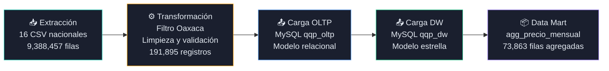
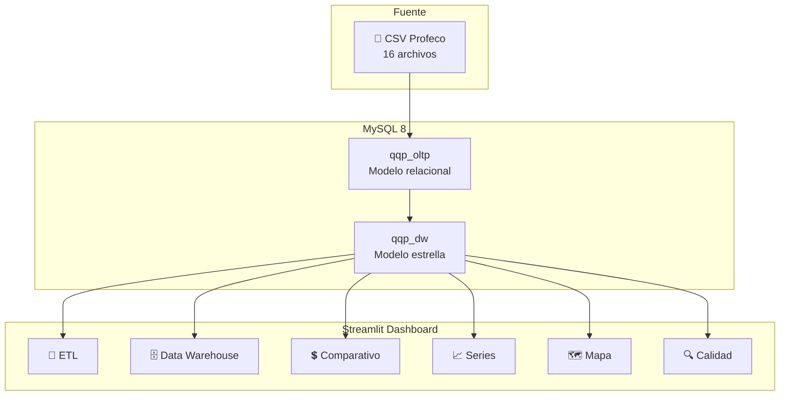

# 🛒 QQP Oaxaca Dashboard

[](https://www.python.org/)
[](https://streamlit.io/)
[](https://plotly.com/)
[](https://www.mysql.com/)
[](https://creativecommons.org/licenses/by/4.0/deed.es)
[](https://www.tecnm.mx/)

Dashboard web interactivo que visualiza la **carga de un proceso ETL** y permite la **exploración de datos** del programa *Quién es Quién en los Precios* de la Profeco, filtrado a precios del estado de **Oaxaca, enero–agosto 2026**.

> **Proyecto escolar** · TecNM Campus Oaxaca · Ingeniería en Sistemas Computacionales

---

## 📌 Descripción del proyecto

Este dashboard fue desarrollado como proyecto de la materia de **Toma de Decisiones** y cubre:

- Visualización del proceso ETL que procesó **9,388,457 filas** nacionales para conservar **191,895 registros de Oaxaca**.
- Exploración del Data Warehouse en modelo en estrella (`qqp_dw`) y el Data Mart `agg_precio_mensual`.
- Comparativo de precios por cadena comercial, evolución temporal, mapa de establecimientos y análisis de calidad de datos.

---

## 📂 Fuente de datos

| Atributo | Valor |
|---|---|
| **Programa** | Quién es Quién en los Precios (QQP) |
| **Organismo** | Procuraduría Federal del Consumidor (Profeco) |
| **URL** | https://www.gob.mx/profeco/documentos/quien-es-quien-en-los-precios |
| **Período** | Enero–Agosto 2026 |
| **Filtro geográfico** | Estado de Oaxaca |
| **Licencia** | [Creative Commons BY 4.0](https://creativecommons.org/licenses/by/4.0/deed.es) |

---

## 🔄 Etapas del proceso ETL



| Métrica | Valor |
|---|---|
| Archivos fuente | 16 CSV (Q1 y Q2 de cada mes) |
| Filas leídas | 9,388,457 |
| Registros de Oaxaca | 191,903 |
| Duplicados exactos eliminados | 8 |
| Registros cargados | 191,895 |
| Duración del proceso | 2 min 38 s |

---

## 🏗️ Arquitectura



---

## ⚙️ Requisitos

- Python 3.11 o superior
- MySQL 8.0 con los esquemas `qqp_dw` y `qqp_oltp` cargados
- Windows 10/11 (o Linux/macOS con ajustes mínimos)

---

## 🚀 Instalación (Windows)

### 1. Clonar el repositorio

```powershell
git clone https://github.com/LeonardoSGP/qqp-oaxaca-dashboard.git
cd qqp-oaxaca-dashboard
```

### 2. Crear entorno virtual

```powershell
python -m venv .venv
.venv\Scripts\Activate.ps1
```

### 3. Instalar dependencias

```powershell
pip install -r requirements.txt
```

### 4. Configurar variables de entorno

```powershell
copy .env.example .env
notepad .env
```

Rellena el archivo `.env` con tus credenciales de MySQL:

```env
MYSQL_HOST=localhost
MYSQL_PORT=3306
MYSQL_USER=usuario_readonly
MYSQL_PASSWORD=tu_contraseña
MYSQL_DB_DW=qqp_dw
MYSQL_DB_OLTP=qqp_oltp
```

> **⚠️ NUNCA subas el archivo `.env` al repositorio.** Ya está incluido en `.gitignore`.

---

## 🔐 Crear usuario MySQL de solo lectura

Ejecuta en MySQL como administrador:

```sql
-- Crear usuario
CREATE USER 'qqp_reader'@'localhost' IDENTIFIED BY 'contraseña_segura';

-- Otorgar permisos de solo lectura en ambos esquemas
GRANT SELECT ON qqp_dw.*   TO 'qqp_reader'@'localhost';
GRANT SELECT ON qqp_oltp.* TO 'qqp_reader'@'localhost';

-- Aplicar cambios
FLUSH PRIVILEGES;
```

Luego usa `qqp_reader` como valor de `MYSQL_USER` en tu `.env`.

---

## ▶️ Ejecutar el dashboard

```powershell
streamlit run app.py
```

La aplicación abre automáticamente en `http://localhost:8501`.

---

## 🎭 Modo demo (sin MySQL)

Si la aplicación **no puede conectarse a MySQL**, activa automáticamente el **modo demo** y muestra datos de muestra pre-generados desde `data/sample/`.

Para generar los archivos de muestra desde MySQL (solo necesitas hacerlo una vez):

```powershell
python scripts/export_sample.py
```

---

## 📁 Estructura de carpetas

```
qqp-oaxaca-dashboard/
├── app.py                      # Punto de entrada del dashboard
├── pages/                      # Páginas de navegación multipágina
│   ├── 1_🔄_Carga_de_datos_ETL.py
│   ├── 2_🗄️_Data_Warehouse.py
│   ├── 3_💲_Comparativo_de_Precios.py
│   ├── 4_📈_Series_de_Tiempo.py
│   ├── 5_🗺️_Mapa.py
│   └── 6_🔍_Calidad_de_Datos.py
├── src/                        # Módulos de lógica de negocio
│   ├── __init__.py
│   ├── db.py                   # Conexión SQLAlchemy
│   ├── queries.py              # Consultas SQL con caché
│   ├── charts.py               # Funciones de gráficas Plotly
│   └── etl_info.py             # Lectura del resumen ETL (JSON)
├── data/
│   ├── etl_resumen.json        # Métricas del proceso ETL
│   └── sample/                 # CSV de muestra para modo demo
├── docs/
│   └── img/                    # Capturas del dashboard
├── scripts/
│   └── export_sample.py        # Exporta muestras desde MySQL
├── tests/
│   └── test_etl_info.py        # Pruebas unitarias (pytest)
├── .streamlit/
│   └── config.toml             # Tema oscuro del dashboard
├── .env.example                # Plantilla de variables de entorno
├── .gitignore
├── requirements.txt
└── README.md
```

---

## 📄 Páginas del dashboard

### 🔄 Página 1 — Carga de datos (ETL)

Muestra el flujo completo del proceso ETL con:
- Tarjetas de las tres etapas (Extracción, Transformación, Carga)
- KPIs: archivos procesados, filas leídas, registros de Oaxaca, duplicados, finales, duración
- Embudo de flujo de filas
- Barras de filas por archivo CSV
- Tabla de reglas de limpieza
- **Conciliación en vivo**: consulta MySQL y compara conteos reales vs esperados

📸 *(Captura disponible en `docs/img/etl.png`)*

---

### 🗄️ Página 2 — Data Warehouse y Data Mart

- Diagrama ER del modelo en estrella
- Conteo de filas por tabla (gráfica de barras)
- Vista previa paginada de cada tabla (hasta 200 filas)
- Descripción del Data Mart `agg_precio_mensual`

📸 *(Captura disponible en `docs/img/dw.png`)*

---

### 💲 Página 3 — Comparativo de precios

- Filtros: categoría → producto (en la barra lateral)
- KPIs: precio promedio, mínimo, máximo, número de cadenas
- Gráfica de barras horizontales por cadena comercial
- Tabla detallada con mínimo, máximo y registros

📸 *(Captura disponible en `docs/img/precios.png`)*

---

### 📈 Página 4 — Series de tiempo

- Selector de producto y multiselector de cadenas comerciales
- Gráfica de líneas con evolución mensual del precio promedio
- Tabla de datos subyacente

📸 *(Captura disponible en `docs/img/series.png`)*

---

### 🗺️ Página 5 — Mapa

- Establecimientos con coordenadas válidas en Oaxaca
- Mapa de burbujas con `carto-darkmatter` (sin token requerido)
- Tamaño y color proporcional al número de registros
- Filtro por cadena comercial

📸 *(Captura disponible en `docs/img/mapa.png`)*

---

### 🔍 Página 6 — Calidad de datos

- KPIs de calidad: rechazados, duplicados, coordenadas nulas, precios atípicos
- Tabla de completitud por etapa ETL
- Análisis de nulos por columna (MySQL en vivo)
- Establecimientos fuera del bounding box de Oaxaca
- Notas e interpretación de la calidad

📸 *(Captura disponible en `docs/img/calidad.png`)*

---

## 📖 Diccionario de datos

### `fact_precio`

| Columna | Tipo | Descripción |
|---|---|---|
| `id_registro` | INT | Llave primaria |
| `sk_producto` | INT | FK → `dim_producto` |
| `sk_establecimiento` | INT | FK → `dim_establecimiento` |
| `id_tiempo` | DATE | FK → `dim_tiempo` |
| `precio` | DECIMAL | Precio registrado en MXN |

### `dim_producto`

| Columna | Tipo | Descripción |
|---|---|---|
| `sk_producto` | INT | Llave surrogada |
| `id_presentacion_origen` | INT | ID original del OLTP |
| `producto` | VARCHAR | Nombre genérico del producto |
| `presentacion` | VARCHAR | Descripción de la presentación |
| `marca` | VARCHAR | Marca comercial |
| `categoria` | VARCHAR | Categoría Profeco |
| `catalogo` | VARCHAR | Catálogo Profeco |

### `dim_establecimiento`

| Columna | Tipo | Descripción |
|---|---|---|
| `sk_establecimiento` | INT | Llave surrogada |
| `nombre_comercial` | VARCHAR | Nombre de la tienda |
| `cadena_comercial` | VARCHAR | Cadena/grupo comercial |
| `giro` | VARCHAR | Tipo de establecimiento |
| `direccion` | VARCHAR | Dirección completa |
| `municipio` | VARCHAR | Municipio de Oaxaca |
| `estado` | VARCHAR | Estado (siempre "OAXACA") |
| `latitud` | FLOAT | Coordenada geográfica |
| `longitud` | FLOAT | Coordenada geográfica |

### `dim_tiempo`

| Columna | Tipo | Descripción |
|---|---|---|
| `id_tiempo` | DATE | Llave primaria (fecha) |
| `anio` | INT | Año |
| `trimestre` | INT | Trimestre (1–4) |
| `mes` | INT | Mes (1–12) |
| `nombre_mes` | VARCHAR | Nombre del mes en español |
| `dia` | INT | Día del mes |
| `semana_iso` | INT | Semana ISO del año |
| `dia_semana` | VARCHAR | Nombre del día |
| `es_dia_habil` | BOOL | 1 = día hábil |

### `agg_precio_mensual` (Data Mart)

| Columna | Tipo | Descripción |
|---|---|---|
| `mes` | INT | Mes del año (1–8) |
| `producto` | VARCHAR | Nombre del producto |
| `presentacion` | VARCHAR | Presentación |
| `marca` | VARCHAR | Marca |
| `categoria` | VARCHAR | Categoría Profeco |
| `cadena_comercial` | VARCHAR | Cadena de supermercado |
| `estado` | VARCHAR | Estado |
| `precio_promedio` | DECIMAL | Promedio del mes |
| `precio_minimo` | DECIMAL | Mínimo del mes |
| `precio_maximo` | DECIMAL | Máximo del mes |
| `num_registros` | INT | Observaciones del mes |

---

## 🛠️ Tecnologías

| Tecnología | Versión | Uso |
|---|---|---|
| Python | 3.11+ | Lenguaje principal |
| Streamlit | 1.35+ | Framework del dashboard |
| Plotly | 5.22+ | Visualizaciones interactivas |
| Pandas | 2.2+ | Manipulación de datos |
| SQLAlchemy | 2.0+ | ORM y conexión a MySQL |
| PyMySQL | 1.1+ | Driver MySQL para Python |
| python-dotenv | 1.0+ | Variables de entorno |
| MySQL | 8.0 | Base de datos |
| pytest | 8.0+ | Pruebas unitarias |

---

## ⚠️ Limitaciones

- El módulo de **conciliación** y el análisis de **nulos en vivo** requieren conexión a MySQL.
- El **modo demo** usa datos de muestra reducidos; las gráficas son representativas pero no exhaustivas.
- El **mapa** omite los 940 establecimientos sin coordenadas.
- Los datos cubren únicamente **enero–agosto 2026** del estado de **Oaxaca**.
- Las coordenadas geográficas provienen del dataset de Profeco y pueden contener imprecisiones.

---

## 👨‍💻 Autor

**Leonardo Sadot García Pino**  
Ingeniería en Sistemas Computacionales  
TecNM Campus Oaxaca · 2026

---

## 📜 Licencia de los datos

Los datos utilizados provienen del programa público *Quién es Quién en los Precios* de la **Procuraduría Federal del Consumidor (Profeco)**, disponibles como datos abiertos bajo licencia **[Creative Commons BY 4.0](https://creativecommons.org/licenses/by/4.0/deed.es)**.

**Atribución requerida:** Profeco · Quién es Quién en los Precios · https://www.gob.mx/profeco
