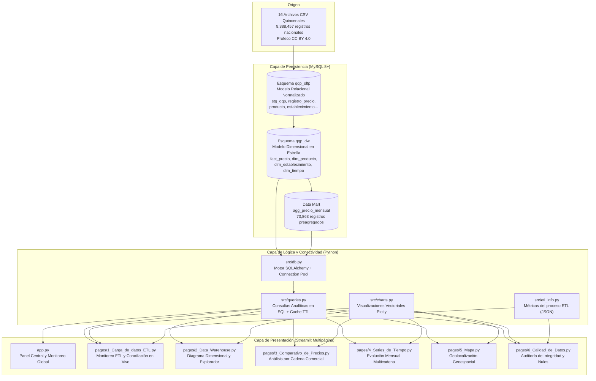

# Documentación Técnica del Sistema
## Dashboard de Monitoreo ETL y Análisis de Precios QQP Oaxaca 2026

**Institución:** Instituto Tecnológico de Oaxaca (TecNM Campus Oaxaca)  
**Programa Académico:** Ingeniería en Sistemas Computacionales  
**Materia:** Toma de Decisiones  
**Autor:** LeonardoSGP (Leonardo Sadot García Pino)  
**Versión del Sistema:** v1.0.0  
**Fecha:** Noviembre 2026  

---

## 1. Resumen Ejecutivo del Sistema

El sistema **QQP Oaxaca Dashboard** es una solución analítica full-stack basada en Python que permite supervisar la extracción, transformación y carga (ETL) de datos abiertos del programa nacional *Quién es Quién en los Precios* (Profeco) y explorar interactivamente el Data Warehouse resultante centrado exclusivamente en el estado de Oaxaca para el período enero-agosto de 2026.

El pipeline procesó **9,388,457 filas** provenientes de 16 archivos CSV quincenales a nivel nacional, filtrando y normalizando **191,895 registros válidos** en esquemas relacionales (OLTP) y multidimensionales en estrella (DW) sobre MySQL 8+.

---

## 2. Arquitectura General del Sistema



---

## 3. Modelo de Datos y Esquemas MySQL

El sistema opera sobre dos esquemas complementarios en MySQL:

### 3.1 Esquema Relacional Operacional (`qqp_oltp`)
Encargado de la persistencia transaccional y normalización de catálogos:
- `stg_qqp`: Tabla de staging que almacena la carga cruda de Oaxaca (191,895 registros).
- `v_stg_limpio`: Vista de depuración con tipos de datos casteados y campos limpios.
- `registro_precio`: Registro unitario normalizado de cada observación de precio.
- Tablas maestras normalizadas: `producto`, `presentacion_producto`, `cadena_comercial`, `giro`, `establecimiento`, `municipio`, `entidad`, `categoria`, `catalogo`, `marca`.

### 3.2 Esquema Dimensional Data Warehouse (`qqp_dw`)
Implementa un modelo en estrella (*Star Schema*) optimizado para consultas de soporte a decisiones (OLAP):

```mermaid
erDiagram
    fact_precio {
        int id_registro PK
        int sk_producto FK
        int sk_establecimiento FK
        date id_tiempo FK
        decimal precio
    }
    dim_producto {
        int sk_producto PK
        int id_presentacion_origen
        string producto
        string presentacion
        string marca
        string categoria
        string catalogo
    }
    dim_establecimiento {
        int sk_establecimiento PK
        int id_establecimiento_origen
        string nombre_comercial
        string cadena_comercial
        string giro
        string direccion
        string municipio
        string estado
        float latitud
        float longitud
    }
    dim_tiempo {
        date id_tiempo PK
        date fecha
        int anio
        int trimestre
        int mes
        string nombre_mes
        int dia
        int semana_iso
        string dia_semana
        bool es_dia_habil
    }
    fact_precio }o--|| dim_producto : "sk_producto"
    fact_precio }o--|| dim_establecimiento : "sk_establecimiento"
    fact_precio }o--|| dim_tiempo : "id_tiempo"
```



#### Diccionario Dimensional
1. **`fact_precio` (Tabla de Hechos):**
   - Granularidad: Un precio registrado por presentación de producto en un establecimiento en una fecha dada.
   - Volumen: 191,895 filas.
   - Métricas: `precio` (DECIMAL).
2. **`dim_producto`:** 3,265 presentaciones únicas agrupadas en 781 productos genéricos y marcas registradas.
3. **`dim_establecimiento`:** 51 tiendas comerciales monitoreadas en Oaxaca con coordenadas de latitud/longitud y municipio.
4. **`dim_tiempo`:** Dimensión temporal calendario (5,844 registros) con atributos jerárquicos (año, trimestre, mes, día, semana ISO, indicador hábil).

### 3.3 Data Mart: `agg_precio_mensual`
Tabla agregada precalculada en el DW con **73,863 filas**.
- **Propósito:** Evita agregar al vuelo sobre las 191,895 filas de `fact_precio` en cada interacción del usuario, reduciendo el tiempo de respuesta de segundos a milisegundos.
- **Granularidad:** Mes + Producto + Presentación + Marca + Cadena Comercial + Estado.
- **Métricas:** `precio_promedio`, `precio_minimo`, `precio_maximo`, `num_registros`.

---

## 4. Estructura del Código y Módulos de Lógica

```
qqp-oaxaca-dashboard/
├── app.py                      # Punto de entrada y panel general
├── pages/                      # Páginas del dashboard multipágina
│   ├── 1_Carga_de_datos_ETL.py
│   ├── 2_Data_Warehouse.py
│   ├── 3_Comparativo_de_Precios.py
│   ├── 4_Series_de_Tiempo.py
│   ├── 5_Mapa.py
│   └── 6_Calidad_de_Datos.py
├── src/                        # Capa de negocio y datos
│   ├── db.py                   # Conexión SQLAlchemy y verificación
│   ├── queries.py              # Consultas SQL optimizadas
│   ├── charts.py               # Generación de gráficos Plotly
│   └── etl_info.py             # Parser del JSON de auditoría ETL
├── data/
│   ├── etl_resumen.json        # Metadatos auditados del proceso ETL
│   └── sample/                 # Muestras CSV exportadas
├── scripts/
│   └── export_sample.py        # Generador de respaldos de muestra
├── tests/
│   └── test_etl_info.py        # Suite de pruebas unitarias
├── .streamlit/
│   └── config.toml             # Configuración del tema visual oscuro
├── .env.example                # Plantilla de variables de entorno
└── README.md                   # Documentación principal
```

### 4.1 Módulo `src/db.py`
- Gestiona motores SQLAlchemy independientes mediante `@st.cache_resource` para `qqp_dw` y `qqp_oltp`.
- Configura `pool_pre_ping=True` y `pool_recycle=3600` para garantizar resiliencia ante cortes de conexión.
- Expone `test_connection()` que ejecuta `SELECT VERSION()` y reporta el estado exacto de la base de datos.

### 4.2 Módulo `src/queries.py`
- Centraliza todas las consultas analíticas del sistema.
- Aplica decoradores `@st.cache_data(ttl=300)` para almacenamiento en memoria de resultados frecuentes.
- Regla de diseño: **Las agregaciones (`AVG`, `MIN`, `MAX`, `SUM`, `COUNT`) se ejecutan en el motor MySQL**, transportando únicamente el resultado resumido a Pandas.

### 4.3 Módulo `src/charts.py`
- Define la paleta gráfica coherente del sistema:
  - Fondo primario: `#0E1117`
  - Fondo secundario de tarjeta: `#1A1F2E`
  - Acento primario (Teal): `#2DD4BF`
  - Acento de advertencia (Amber): `#F59E0B`
  - Texto principal: `#E2E8F0`
- Genera visualizaciones vectoriales interactivas en Plotly: embudos de flujo, barras horizontales, líneas temporales con marcadores y mapas de burbujas geoespaciales.

### 4.4 Módulo `src/etl_info.py`
- Lee y estructura el archivo `data/etl_resumen.json`.
- Proporciona DataFrames de las filas procesadas por archivo CSV, las reglas de limpieza aplicadas y las tablas objetivo para conciliación.

---

## 5. Catálogo Detallado de Vistas y Funcionalidades

### 5.1 Vista de Inicio (`app.py`)
- **Objetivo:** Panel de bienvenida, estado de infraestructura y resumen cuantitativo.
- **Componentes:**
  - Sidebar con indicador de conectividad en tiempo real (`Conectado a MySQL · MySQL 9.7.0` o mensaje de error de conexión).
  - 4 tarjetas KPI globales: Filas leídas (9,388,457), Registros de Oaxaca (191,895), Productos únicos (3,265) y Establecimientos (51).
  - Tabla índice de navegación hacia las 6 páginas especializadas.

### 5.2 Página 1: Carga de Datos (ETL) (`pages/1_Carga_de_datos_ETL.py`)
- **Objetivo:** Monitoreo visual de la canalización de datos y conciliación automática contra MySQL.
- **Funcionalidades:**
  - **Tarjetas de Flujo ETL:** Desglose conceptual de las etapas de Extracción, Transformación y Carga.
  - **KPIs del Pipeline:** Total de archivos (16), filas leídas, filtradas para Oaxaca, duplicados eliminados (8), registros finales y duración (2 min 38 s).
  - **Gráfico de Embudo:** Muestra la reducción proporcional de 9.3M filas nacionales a 191.9K registros de Oaxaca.
  - **Barras por Archivo CSV:** Distribución de volumen de cada una de las 16 quincenas del período enero–agosto 2026.
  - **Tabla de Reglas de Limpieza:** Catálogo de reglas aplicadas con su respectiva volumetría.
  - **Conciliación en Vivo:** Ejecuta dinámicamente `SELECT COUNT(*)` contra cada tabla y vista de `qqp_dw` y `qqp_oltp`, calcula la diferencia contra el conteo esperado (`diff = real - esperado`) y genera un badge de estado (`OK`, `DIFERENCIA` o `ERROR`).

### 5.3 Página 2: Data Warehouse y Data Mart (`pages/2_Data_Warehouse.py`)
- **Objetivo:** Inspección del modelo multidimensional y exploración de registros tabulares.
- **Funcionalidades:**
  - **Diagrama Mermaid del Star Schema:** Representación visual de las relaciones de clave foránea entre `fact_precio` y sus dimensiones.
  - **Conteos Reales:** Gráfica de barras horizontales con el volumen de cada tabla dimensional y de hechos.
  - **Explicación del Data Mart:** Documentación técnica de la tabla `agg_precio_mensual` y su impacto en el rendimiento OLAP.
  - **Explorador Paginado:** Pestañas interactivas para previsualizar hasta 200 filas de `fact_precio`, `dim_producto`, `dim_establecimiento`, `dim_tiempo` y `agg_precio_mensual`.

### 5.4 Página 3: Comparativo de Precios (`pages/3_Comparativo_de_Precios.py`)
- **Objetivo:** Análisis de dispersión de precios de productos entre cadenas comerciales competidoras.
- **Funcionalidades:**
  - **Filtros Dinámicos (Sidebar):** Selector jerárquico de Categoría (con filtro previo) y Producto (autoselección predeterminada en productos de alta demanda como leche).
  - **Tarjetas KPI del Producto:** Precio promedio global, precio mínimo absoluto, precio máximo absoluto y cantidad de cadenas que comercializan el artículo.
  - **Gráfica de Precios por Cadena:** Barras horizontales con etiquetas de precio en formato moneda (`$XX.XX`), ordenadas de menor a mayor precio promedio.
  - **Tabla Desglosada:** Detalle tabular con precio promedio, mínimo, máximo y volumen de observaciones por cadena.

### 5.5 Página 4: Series de Tiempo (`pages/4_Series_de_Tiempo.py`)
- **Objetivo:** Estudio de la tendencia inflacionaria y estacionalidad de precios a lo largo del año.
- **Funcionalidades:**
  - **Selectores:** Categoría, Producto y multiselector de cadenas comerciales a comparar simultáneamente.
  - **KPIs Temporales:** Promedio global del producto, mínimo histórico mensual, máximo histórico mensual y meses con registros.
  - **Gráfica de Tendencia:** Líneas temporales multicadena (Plotly) a través de los meses 1 al 8 con marcadores y tooltips detallados.
  - **Tabla Pivote Mensual:** Matriz de datos con Cadenas en filas y Meses en columnas para inspección numérica directa.

### 5.6 Página 5: Mapa Geoespacial (`pages/5_Mapa.py`)
- **Objetivo:** Distribución territorial de los puntos de venta monitoreados en el estado de Oaxaca.
- **Funcionalidades:**
  - **Proyección Cartográfica:** Mapa `Scattermapbox` con estilo libre `carto-darkmatter` centrado en Oaxaca (sin requerimiento de API Key externa).
  - **Codificación Visual:** Burbujas posicionadas por latitud y longitud; tamaño y color condicionados por el número total de registros recopilados en cada tienda.
  - **Filtro de Cadenas:** Permite aislar establecimientos de supermercados específicos (Bodega Aurrera, Chedraui, Soriana, Walmart, etc.).
  - **Inventario Georreferenciado:** Tabla con nombre comercial, cadena, municipio, coordenadas y volumen de registros.

### 5.7 Página 6: Calidad de Datos (`pages/6_Calidad_de_Datos.py`)
- **Objetivo:** Auditoría de integridad, completitud y anomalías en el dataset.
- **Funcionalidades:**
  - **Métricas de Control de Calidad:** Rechazados por error sintáctico (0), duplicados idénticos depurados (8), registros con coordenadas nulas (940), llaves repetidas con precio distinto (6,694) y precios atípicos detectados (1).
  - **Completitud por Etapa:** Porcentaje de retención y limpieza entre extracción, filtrado y carga final.
  - **Auditoría de Nulos en Vivo:** Consulta SQL directa sobre columnas críticas (`latitud`, `longitud`, `precio`, `marca`) graficando el porcentaje de nulidad.
  - **Validación Geoespacial:** Verificación de coordenadas que caen fuera del *bounding box* oficial del estado de Oaxaca (latitud 15.6–18.2, longitud -98.6–-93.6).

---

## 6. Pruebas Unitarias y Aseguramiento de Calidad

El proyecto cuenta con una suite de pruebas automatizadas mediante `pytest` en `tests/test_etl_info.py` que valida la lógica de negocio y visualización sin requerir conexión a base de datos:

| ID | Prueba | Componente Evaluado |
|---|---|---|
| 01 | `test_cargar_resumen_devuelve_dict` | Integridad de carga de `data/etl_resumen.json` |
| 02 | `test_resumen_general_claves` | Presencia de llaves requeridas en el JSON |
| 03 | `test_resumen_valores_correctos` | Validación de cifras clave (9,388,457 filas, 191,895 finales) |
| 04 | `test_filas_por_archivo_dataframe` | Tipado y estructura del DataFrame de archivos |
| 05 | `test_filas_por_archivo_total` | Suma exacta de filas de los 16 archivos (9,388,457) |
| 06 | `test_reglas_limpieza_dataframe` | Estructura de reglas de depuración |
| 07 | `test_tablas_esperadas_dataframe` | Lista de 10 tablas objetivo con conteos esperados |
| 08 | `test_formato_miles` | Utilidad de formato numérico con separador de miles |
| 09 | `test_formato_precio` | Formato monetario en pesos mexicanos |
| 10 | `test_embudo_etl_devuelve_figura` | Generación correcta del gráfico de embudo Plotly |
| 11 | `test_barras_por_archivo_devuelve_figura` | Generación del gráfico de barras por archivo |
| 12 | `test_barras_precio_cadena` | Generación de comparativa de precios por cadena |
| 13 | `test_linea_serie_tiempo` | Generación de gráfico temporal multicadena |

**Resultado de ejecución:** 13 pruebas aprobadas (100% de éxito).

---

## 7. Guía de Despliegue y Configuración

### 7.1 Variables de Entorno (`.env`)
El archivo `.env` en la raíz del proyecto define los parámetros de conexión:
```env
MYSQL_HOST=localhost
MYSQL_PORT=3306
MYSQL_USER=tu_usuario
MYSQL_PASSWORD=tu_contraseña
MYSQL_DB_DW=qqp_dw
MYSQL_DB_OLTP=qqp_oltp
```

### 7.2 Permisos de Base de Datos Recomendados
Para entornos de consulta y visualización, se sugiere otorgar únicamente permisos de lectura:
```sql
CREATE USER 'qqp_reader'@'localhost' IDENTIFIED BY 'contraseña_segura';
GRANT SELECT ON qqp_dw.* TO 'qqp_reader'@'localhost';
GRANT SELECT ON qqp_oltp.* TO 'qqp_reader'@'localhost';
FLUSH PRIVILEGES;
```

### 7.3 Comandos de Ejecución
```powershell
# Ejecutar pruebas unitarias
python -m pytest tests/test_etl_info.py -v

# Generar o actualizar respaldo de muestras
python scripts/export_sample.py

# Iniciar servidor web del dashboard
streamlit run app.py
```
Acceso en navegador: `http://localhost:8501`.
